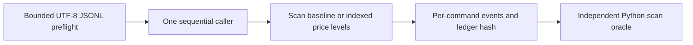

# Price-Time Matching Core

A small C#/.NET 10 library and offline CLI for **one synthetic instrument**. Submit limit orders and cancels, inspect ordered synthetic trades, and reproduce the resulting book from the same ordered input.

The interesting decision is explicit: accepted command sequence defines FIFO. A rejected command leaves the ledger, sequence and trade output unchanged. Two safe C# implementations and a separate Python model check that contract after every command.

## Decision and proof first

| Decision | Executable proof |
| --- | --- |
| Better price precedes arrival; equal-price orders keep FIFO after partial fills | `PricePriorityPrecedesArrivalAndMakerPriceDeterminesTrade`, `SamePriceFifoSurvivesPartialFillAndInterveningRejection`; `examples/priority.jsonl` |
| Execution uses the resting order's price | Independent oracle compares every ordered trade, including price, maker, quantity and deterministic ID |
| Capacity and checked arithmetic reject before effects | Prospective-capacity tests, full 10,000 boundary and overflow counterexamples in `MatcherTests.cs` |
| Each accepted order conserves quantity | Per-command ledger hashes and full final ledger checked by a differently structured Python model |
| After stopping, rebuild from original ordered input | Demo runs indexed replay twice and compares exact events/final bytes with the scan baseline; there is no durable book recovery claim |
| Invalid JSON or framing anywhere prevents all processing | Twelve hostile-file cases plus 16 byte-framing regressions, including terminal bare CR, multiple rows, exact 4,096-byte boundaries and valid LF/CRLF/final EOF controls |

## Start with the demo

Published preview: [`v0.1.0-preview.1`](https://github.com/pouriajamali/price-time-matching-core/releases/tag/v0.1.0-preview.1). Download **[Windows x64](https://github.com/pouriajamali/price-time-matching-core/releases/download/v0.1.0-preview.1/price-time-matching-core-v0.1.0-preview.1-win-x64.zip)**, **[Linux x64](https://github.com/pouriajamali/price-time-matching-core/releases/download/v0.1.0-preview.1/price-time-matching-core-v0.1.0-preview.1-linux-x64.tar.gz)** or [source](https://github.com/pouriajamali/price-time-matching-core/releases/download/v0.1.0-preview.1/price-time-matching-core-v0.1.0-preview.1-source.zip). Get the [checksums](https://github.com/pouriajamali/price-time-matching-core/releases/download/v0.1.0-preview.1/SHA256SUMS.txt), [checksum signature](https://github.com/pouriajamali/price-time-matching-core/releases/download/v0.1.0-preview.1/SHA256SUMS.txt.sig) and [public key](https://github.com/pouriajamali/price-time-matching-core/releases/download/v0.1.0-preview.1/SIGNING-PUBLIC-KEY.pub); verify downloaded bytes with [PROVENANCE.md](PROVENANCE.md) before executing them. Local builds and CI artifacts are separate from published releases.

Windows x64 ZIP and Linux x64 tar.gz contain the self-contained runtime, examples, Python verifier and full notices. Python 3.12+ is needed for independent evidence, not for the CLI itself.

Windows PowerShell, from the extracted directory:

```powershell
.\matching.exe run examples/priority.jsonl my-first-replay indexed
Get-Content my-first-replay/events.jsonl
python tools/oracle.py --input examples/priority.jsonl --output my-first-replay --receipt my-first-oracle.json
python tools/native_demo.py --cli .\matching.exe --out complete-native-demo
```

Linux:

```sh
./matching run examples/priority.jsonl my-first-replay indexed
python3 tools/oracle.py --input examples/priority.jsonl --output my-first-replay --receipt my-first-oracle.json
python3 tools/native_demo.py --cli ./matching --out complete-native-demo
```

Choose a **new output directory** each time. CLI `COMPLETE_NOT_INDEPENDENT_PROOF` means bounded processing completed; the oracle must separately pass. The native demo checks four histories, 1,807 commands per implementation, 12 runs, 12 hostile inputs, 16 byte-framing regressions and eight deliberate output corruptions. Runtime limits can stop a larger replay; incomplete files are never a passing receipt.

## Input and output

Each UTF-8 JSONL row is one command. Units are positive integer price ticks and quantity units, both 1..1,000,000. There is no currency conversion, floating price, account, network or exchange adapter. Cancel has no side/price/quantity fields. Order IDs are lowercase ASCII alphanumeric/hyphen, 1..32 characters, starting alphanumeric.

```json
{"kind":"limit","orderId":"buy-1","side":"buy","priceTicks":100,"quantity":5}
{"kind":"cancel","orderId":"buy-1"}
```

`events.jsonl` records each input, accepted/rejected result, ordered trades and full-ledger hash. `final.json` contains every accepted order's conservation counters and current bid/ask priority. `receipt.json` identifies exact input bytes and source version. Integer JSON numbers require an exact integer reader; JavaScript floating-point parsing is unsuitable for general Int64 counters.

## Architecture and limits



The baseline copies a plain ledger and scans/sorts candidates. The indexed alternative uses BCL sorted price levels, linked FIFO queues and an ID index. It plans matches and all checked totals before mutation. This is a correctness comparison; the evidence adapter hashes complete ledgers and is **not a latency benchmark**. No speedup is claimed.

At most 10,000 simultaneous resting orders and 100,000 lifetime accepted IDs per library instance; filled/cancelled IDs stay reserved. CLI: 8 MiB input, 4,096 bytes/frame, 20,000 commands, 60-second replay budget, 32 MiB events and 32 MiB final snapshot. All input schema/framing is validated before engine/output creation. Semantic rejections are recorded without effects. Memory-allocation/process/OS failure is outside domain-atomicity guarantees.

One caller owns an instance; it is not thread-safe. Replace, market orders, self-trade prevention, multi-instrument routing, fees, crash durability and venue conformance are excluded. A synthetic trade event is not a real transaction or profitability result.

## Build and review

Source pin: SDK 10.0.404, runtime 10.0.15, C# 14; application uses BCL only. xUnit v3 4.0.3 is test-only. No preview, unsafe code, AOT, services, credentials or package install is needed for the self-contained CLI.

```sh
dotnet restore PriceTimeMatching.slnx --locked-mode
dotnet build PriceTimeMatching.slnx -c Release --no-restore
dotnet run --project tests/Matching.Tests/Matching.Tests.csproj -c Release --no-build
```

See [contract](docs/CONTRACT.md), [decisions](docs/ADR.md), [runbook](docs/RUNBOOK.md), [release scope](docs/RELEASE.md), [provenance](PROVENANCE.md) and [contributing](CONTRIBUTING.md). MIT covers original code; bundled runtime retains its own full notices.

[CI resource policy](docs/CI-POLICY.md): documentation-only changes get real lightweight document/pipeline checks; source, tag and manual runs retain native validation. Published runtime tags and release assets remain unchanged.

## Source readability

The current source expands compact C# layout for review. The published preview links identify its frozen runtime release. Formatting preserves complete syntax, token text and values, comments and directives; it does not introduce a runtime behavior or performance claim.

To reproduce a published package, use its exact original runtime source: [v0.1.0-preview.1 source](https://github.com/pouriajamali/price-time-matching-core/tree/e17d9f9aacdbca9a20d316ae08afb048842a22c6) (`e17d9f9aacdbca9a20d316ae08afb048842a22c6`). Later `main` layout is reviewed separately from those frozen release commits.

## Capacity model source candidate

The source candidate adds twelve literal small-limit histories and their independent Python checks: resting rejection/retry, full-book fills, slot reuse, lifetime IDs after fill/cancel, and FIFO through rejection. Tests compare every complete result and snapshot, repeat exact bytes, and erase rejected commands when comparing accepted projections. Existing matching and CLI logic is unchanged.

New source is prepared for preview.2; it has not passed runtime admission or tests yet. Published preview.1 links above remain the immutable prior release. Current source pins .NET10 servicing10.0.15; existing binaries contain10.0.14. See docs/RUNBOOK.md for the bounded reproduction route and docs/RELEASE.md for candidate limitations.

## Proposed hosted SDK10 input source

Future hosted verification uses the same pinned tools/sdk10_hosted_inputs.py, tools/sdk10-inputs.lock.json and tools/sdk10-members.jsonl source metadata under each actual native row's own cap. These three files belong in the exact Git source archive; SDK archives/materialized payload remain in fresh RUNNER_TEMP/sdk10-input-10-RID and are never committed or uploaded. No setup-dotnet/systemSDK fallback, borrowed qualification, SDK11 dependency or local26H2/WSL product execution is authorized. This is a private source candidate; hosted tests and publication remain gated.

The hosted source now has a complete parent/held-child entry rather than a boolean or an unconditional design exit. Actual FILETIME or Linux start/cgroup identity binds release; the row has a monotonic1140s deadline, staged time limits,8MiB logs and4GiB observed storage. A successful Windows child exit cannot pass if any original Job members remain before cleanup; forced cleanup is failed/incomplete. No localSDK/product or publicCI was executed while preparing this candidate.

Before build/package, a no-download SDK restore-graph generation selects only actual fixed10.0.15 implicit requests, then fixed7-ID/17-lock raw packages pass bounded official-origin acquisition, pinned raw hashes, signature/normalized/member/notices policy, current selected advisories and locked offline-only restore/cache/source checks. The original advisory check is run once before build. Missing/unexpected inputs fail; a source table or SDK receipt is not package admission. The additive10.0.15 runtime notice rows and four public original notice texts are prepared from sealed historical source data; prior10.0.14 rows and policy are retained. This source reuse does not claim current raw/signature/advisory or packaging success. No generated passing package proof is shipped.

The Windows hosted source retains the existing win25 family and adds only ImageOS win25-vs2026 with exact ImageVersion20261103.298.1. Both paths require actual native Windows Server2025/productType3/build26100/x64 observations and retain those raw values in proof; no client26H2, emulation, wildcard or additional image alias is admitted. This mapping has only been checked statically; Ubuntu mapping and all original budgets/cases are unchanged.

Hosted run43934283837 attempt1 of sourcefe7ca7f failed before the native payload on both rows at NUGET_REPOSITORY_SIGNER for microsoft.bcl.asyncinterfaces. Each row had two SDK starts; the retained SDK10 materialization receipts passed in that exact scope. The actual verify report was absent from the uploaded proof, so the underlying parser/certificate cause remains UNKNOWN. The diagnostic-only predecessor added bounded per-package identity, signature-kind, observed fingerprint and verify-exit diagnostics without raw stdout/stderr, paths, queries or environment values; it preserved the then-current identity/signature pins, and retains a failed child cause separately from Linux successful-preexit membership checks. It does not retry the consumed CI gate or claim a repaired native result.

The test-package signer source binds all17 fixed identities to version, rawSHA512, normalized contentHash and exact retained CMS-fileSHA256. Registry5.0.0 uses only0E5F38F5, BCL6.0.0 only5A2901D6 and the other15 packages only1F4B, each within its own exact binding. The Registry reference gap is resolved by the manager-reported official sample matching its retained CMS certificate and2018-04-10..2021-04-14 dates. No global fallback is added. All7 implicit runtime15 entries retain1F4B and the existing Microsoft author pin. Official certificate provenance and CMS DATA decoding are not actual timestamp/chain/revocation verification: dotnet nuget verify--all exit0 with its actual trusted-chain/RFC3161 timestamp checks and every raw/normalized/notices/advisory/payload guard remain mandatory. This source amendment runs only focused Registry source fixtures and does not authorize push, POST or a new SDK/native/CI attempt.

Hosted attempt43945829659/1 of sourcee747 stopped after two SDK starts and successful NuGet verify output on each native row, before payload, with a UTF8 decode error. Root's separate no-body HEAD of the exact vulnerability index returned Content-Encoding:gzip despite Accept-Encoding:identity; this current metadata supports the transport fix but does not reconstruct the old response headers. JSON metadata now accepts only explicit identity or one checked gzip stream, with CRC/ISIZE/EOF validation, strict trailing/multimember rejection, and no encoding autodetection. Raw plus decoded bytes share the original2MiB index/32MiB aggregate advisory/512MiB total ceilings and original absolute deadline; raw package paths and every signer/advisory/payload guard stay intact. A small sanitized phase/encoding/raw+decoded hash receipt is persisted before JSON parsing. Only exact[] is a documented empty vulnerability page; nonempty arrays/malformed shapes fail. This amendment runs finite offline transport fixtures only; no consumer HEAD/GET/SDK/native/CI or public mutation is authorized.

Hosted attempt43952309783/1 of sourced971 passed identity service JSON and bounded gzip vulnerability-index parsing on both rows, then failed ADVISORY_ORIGIN before payload. Root's separate capped SDK0 preflightA recorded the official index members under /v3-vulnerabilities/, including its nested update path. JSON transport now admits only the exact canonical URLs from a validated<=8-member index tuple; its fixed service/index URLs cannot be overridden. Exacthttps/api.nuget.org with no userinfo/query/fragment/non443 port/backslash/percent or literal traversal/ambiguous path is required; redirects and metadata proxies remain disabled. Both metadata origin gates use the same exact-member policy; raw-package/SDK origin rules, all crypto/advisory guards and original byte/deadline/profile caps remain unchanged. This owner performs only changed offline origin fixtures and local signing. RootC must reuse A's stored hash-bound index, fetch each exact page at most once under its approved SDK0/120s envelope, and pass before any new full SDK CI; no owner GET/SDK/CI or public mutation occurs here.
