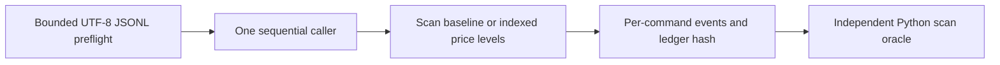

# Price-Time Matching Core

A small C#/.NET 10 library and offline CLI for **one synthetic instrument**. Submit limit orders and cancels, inspect ordered synthetic trades, and reproduce the resulting book from the same ordered input.

The interesting decision is explicit: accepted command sequence defines FIFO. A rejected command leaves the ledger, sequence and trade output unchanged. Two safe C# implementations and a separate Python model check that contract after every command.

## Decision and proof first

| Decision | Executable proof |
| --- | --- |
| Better price precedes arrival; equal-price orders keep FIFO after partial fills | `PricePriorityPrecedesArrivalAndMakerPriceDeterminesTrade`, `SamePriceFifoSurvivesPartialFillAndInterveningRejection`; `examples/priority.jsonl` |
| Execution uses the resting order's price | Independent oracle compares every ordered trade, including price, maker, quantity and deterministic ID |
| Capacity and checked arithmetic reject before effects | Prospective-capacity tests, full 10,000 boundary and overflow counterexamples in `MatcherTests.cs` |
| Each accepted order conserves quantity | Per-command ledger hashes and full final ledger checked by a differently structured Python model |
| After stopping, rebuild from original ordered input | Demo runs indexed replay twice and compares exact events/final bytes with the scan baseline; there is no durable book recovery claim |
| Invalid JSON or framing anywhere prevents all processing | Twelve hostile-file cases plus 16 byte-framing regressions, including terminal bare CR, multiple rows, exact 4,096-byte boundaries and valid LF/CRLF/final EOF controls |

## Start with the demo

Published preview: [`v0.1.0-preview.1`](https://github.com/pouriajamali/price-time-matching-core/releases/tag/v0.1.0-preview.1). Download **[Windows x64](https://github.com/pouriajamali/price-time-matching-core/releases/download/v0.1.0-preview.1/price-time-matching-core-v0.1.0-preview.1-win-x64.zip)**, **[Linux x64](https://github.com/pouriajamali/price-time-matching-core/releases/download/v0.1.0-preview.1/price-time-matching-core-v0.1.0-preview.1-linux-x64.tar.gz)** or [source](https://github.com/pouriajamali/price-time-matching-core/releases/download/v0.1.0-preview.1/price-time-matching-core-v0.1.0-preview.1-source.zip). Get the [checksums](https://github.com/pouriajamali/price-time-matching-core/releases/download/v0.1.0-preview.1/SHA256SUMS.txt), [checksum signature](https://github.com/pouriajamali/price-time-matching-core/releases/download/v0.1.0-preview.1/SHA256SUMS.txt.sig) and [public key](https://github.com/pouriajamali/price-time-matching-core/releases/download/v0.1.0-preview.1/SIGNING-PUBLIC-KEY.pub); verify downloaded bytes with [PROVENANCE.md](PROVENANCE.md) before executing them. Local builds and CI artifacts are separate from published releases.

Windows x64 ZIP and Linux x64 tar.gz contain the self-contained runtime, examples, Python verifier and full notices. Python 3.12+ is needed for independent evidence, not for the CLI itself.

Windows PowerShell, from the extracted directory:

```powershell
.\matching.exe run examples/priority.jsonl my-first-replay indexed
Get-Content my-first-replay/events.jsonl
python tools/oracle.py --input examples/priority.jsonl --output my-first-replay --receipt my-first-oracle.json
python tools/native_demo.py --cli .\matching.exe --out complete-native-demo
```

Linux:

```sh
./matching run examples/priority.jsonl my-first-replay indexed
python3 tools/oracle.py --input examples/priority.jsonl --output my-first-replay --receipt my-first-oracle.json
python3 tools/native_demo.py --cli ./matching --out complete-native-demo
```

Choose a **new output directory** each time. CLI `COMPLETE_NOT_INDEPENDENT_PROOF` means bounded processing completed; the oracle must separately pass. The native demo checks four histories, 1,807 commands per implementation, 12 runs, 12 hostile inputs, 16 byte-framing regressions and eight deliberate output corruptions. Runtime limits can stop a larger replay; incomplete files are never a passing receipt.

## Input and output

Each UTF-8 JSONL row is one command. Units are positive integer price ticks and quantity units, both 1..1,000,000. There is no currency conversion, floating price, account, network or exchange adapter. Cancel has no side/price/quantity fields. Order IDs are lowercase ASCII alphanumeric/hyphen, 1..32 characters, starting alphanumeric.

```json
{"kind":"limit","orderId":"buy-1","side":"buy","priceTicks":100,"quantity":5}
{"kind":"cancel","orderId":"buy-1"}
```

`events.jsonl` records each input, accepted/rejected result, ordered trades and full-ledger hash. `final.json` contains every accepted order's conservation counters and current bid/ask priority. `receipt.json` identifies exact input bytes and source version. Integer JSON numbers require an exact integer reader; JavaScript floating-point parsing is unsuitable for general Int64 counters.

## Architecture and limits



The baseline copies a plain ledger and scans/sorts candidates. The indexed alternative uses BCL sorted price levels, linked FIFO queues and an ID index. It plans matches and all checked totals before mutation. This is a correctness comparison; the evidence adapter hashes complete ledgers and is **not a latency benchmark**. No speedup is claimed.

At most 10,000 simultaneous resting orders and 100,000 lifetime accepted IDs per library instance; filled/cancelled IDs stay reserved. CLI: 8 MiB input, 4,096 bytes/frame, 20,000 commands, 60-second replay budget, 32 MiB events and 32 MiB final snapshot. All input schema/framing is validated before engine/output creation. Semantic rejections are recorded without effects. Memory-allocation/process/OS failure is outside domain-atomicity guarantees.

One caller owns an instance; it is not thread-safe. Replace, market orders, self-trade prevention, multi-instrument routing, fees, crash durability and venue conformance are excluded. A synthetic trade event is not a real transaction or profitability result.

## Build and review

Pinned SDK 10.0.403, runtime 10.0.14, C# 14; application uses BCL only. xUnit v3 4.0.3 is test-only. No preview, unsafe code, AOT, services, credentials or package install is needed for the self-contained CLI.

```sh
dotnet restore PriceTimeMatching.slnx --locked-mode
dotnet build PriceTimeMatching.slnx -c Release --no-restore
dotnet run --project tests/Matching.Tests/Matching.Tests.csproj -c Release --no-build
```

See [contract](docs/CONTRACT.md), [decisions](docs/ADR.md), [runbook](docs/RUNBOOK.md), [release scope](docs/RELEASE.md), [provenance](PROVENANCE.md) and [contributing](CONTRIBUTING.md). MIT covers original code; bundled runtime retains its own full notices.
